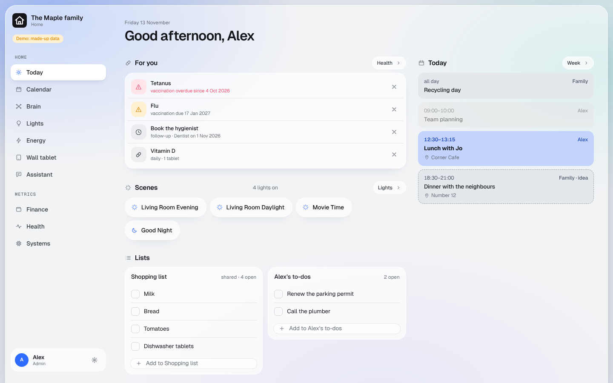
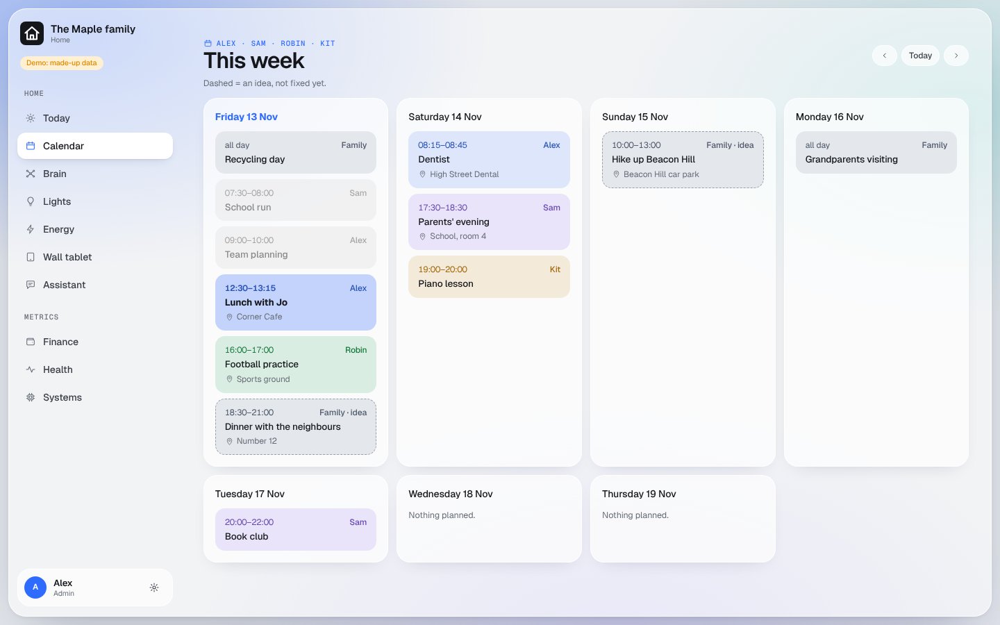
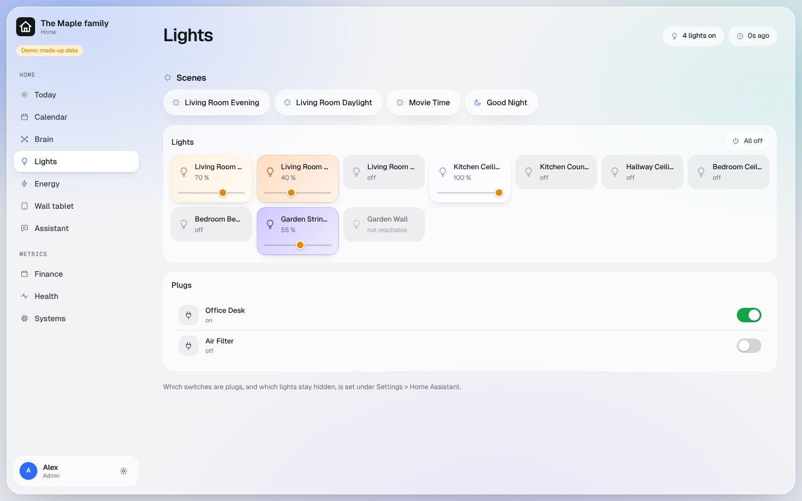
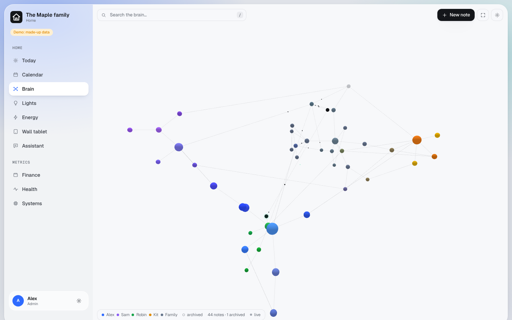
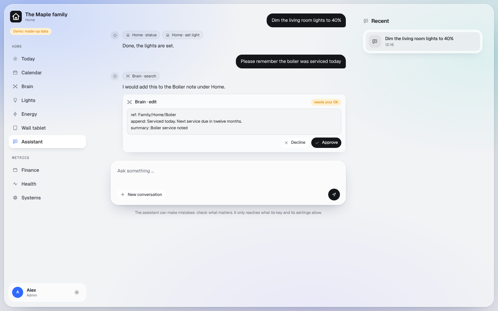
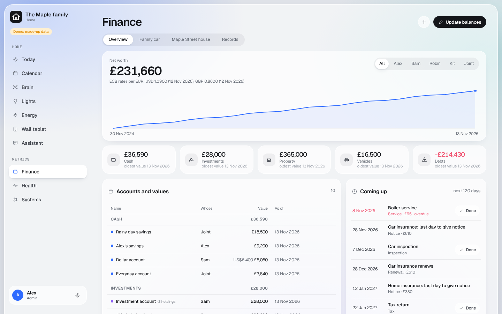
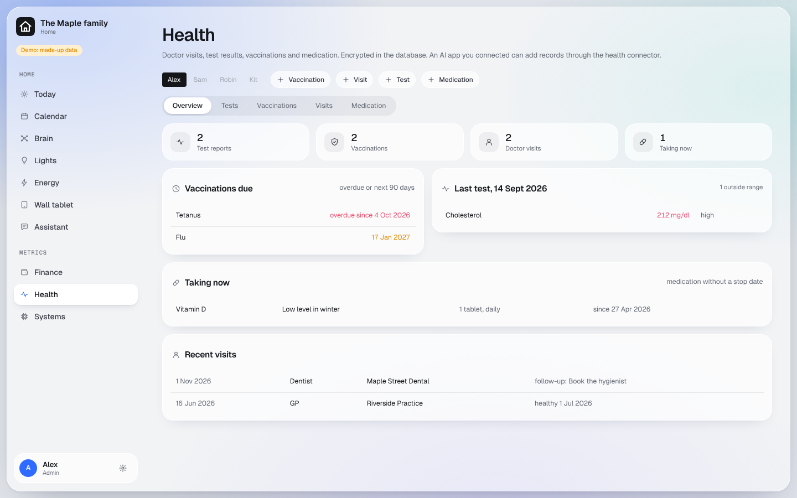
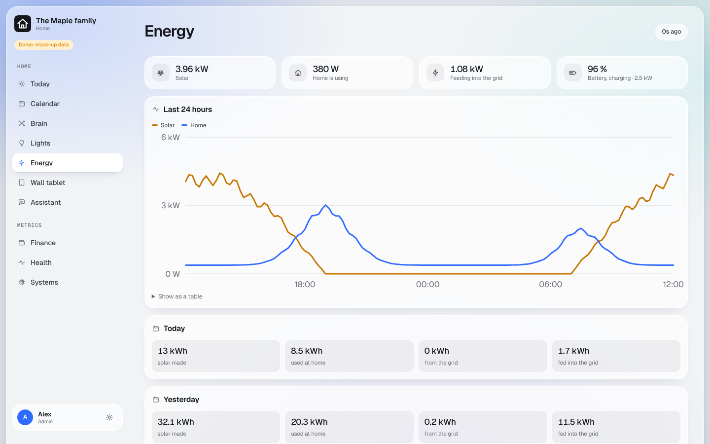
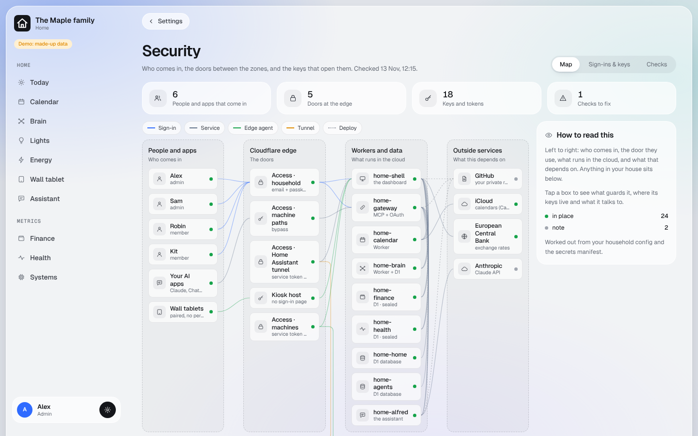

# Smart Home Dashboard by Ruan

A private dashboard for your household that runs on your own Cloudflare account, set up for you by your own AI
(Claude or Codex). Today's calendar, home controls, notes, finances and health records in one place, behind your own
sign-in, with your data in your own databases.

| | |
|---|---|
|  |  |
|  |  |
|  |  |
|  |  |

Every screenshot is demo mode with a made-up family. Try it yourself without an account: install Node.js (22.18 or newer), then
`npm run install:apps` and `npm run demo`, and open the address it prints.

> **First release.** The setup scripts are tested against a stand-in for Cloudflare. Your AI runs every step as a
> dry run first and shows you what it will do before it changes anything.

## How it works

You bring three things. Your AI does the rest.

1. **Accounts.** A GitHub account and a Cloudflare account.
2. **A domain** on Cloudflare (buy one there, or move one you own).
3. **Access for your AI.** Copy this repository into a new **private** repository of your own and give your AI
   access to it. Create a Cloudflare API token that expires within 7 days and store it in your AI's environment,
   never in a chat message.

Then tell your AI: *"Read AGENTS.md and set up my dashboard."* It checks that everything is in place, asks which
modules you want, shows what it will create, builds it, and hands you a list of what now exists.

**Start here: [docs/getting-started.md](docs/getting-started.md)**, a step-by-step guide with every click.

This is a one-time copy. Your private repository is yours to change and extend; it does not receive updates from here.

## Modules

| Module | What you get | Needs |
|---|---|---|
| [Core](docs/modules/core.md) | sign-in with a passkey, a Today page per person, Settings, a Security page | a domain |
| [Gateway](docs/using-your-dashboard.md#connecting-claude-or-chatgpt) | lets your own Claude or ChatGPT app use your dashboard's data (MCP, OAuth) | Core |
| [Brain](docs/modules/brain.md) | a shared notes tree with a 3D map | Core |
| [Calendar](docs/modules/calendar.md) | your iCloud calendars on the Today page | an iCloud app-specific password |
| [Finance](docs/modules/finance.md) | accounts, balances, contracts, deadlines; encrypted | Core |
| [Health](docs/modules/health.md) | per-person health records; encrypted | Core |
| [Data export](docs/modules/data-export.md) | an encrypted zip of everything (**not built yet**) | a data module |
| [Home Assistant](docs/modules/home-assistant.md) | lights, scenes, plugs and lists | Home Assistant with the Cloudflared add-on |
| [Energy](docs/modules/energy.md) | an energy page from your Home Assistant sensors | Home Assistant |
| [Kiosk](docs/modules/kiosk.md) | wall tablets, paired from Settings | Home Assistant |
| [Edge agents](docs/modules/edge-agents.md) | stats from your Mac, Windows or Linux computers | a computer, a Go build |
| [Alfred](docs/modules/alfred.md) | a chat assistant inside the dashboard | an Anthropic API key, billed per use |

## Your secrets

Every secret has one clear name, listed with its purpose in [secrets.manifest.json](secrets.manifest.json). Values
live only in Cloudflare and in your password manager: keep one item there (for example "Home Dashboard") with one
field per name. The encryption keys for your notes, finances and health records are generated in your own browser,
so your AI never sees them. **If you lose an encryption key, the data it protects is gone.** More in
[docs/secrets.md](docs/secrets.md).

## What is in this repository

| Path | What |
|---|---|
| `AGENTS.md` | the setup guide your AI follows |
| `household.config.example.json` | the one file with your household's settings: domain, people, modules |
| `secrets.manifest.json` | every secret by name: what it is for, where it lives, how to replace it |
| `setup/` | the setup scripts your AI runs, the checks, the generator for the Workers' config files |
| `apps/shell` | the dashboard: sign-in, Today, Settings, Security |
| `apps/gateway` | the MCP addresses and the OAuth server for your AI apps |
| `packages/core` | code every Worker shares: the household config, the sign-in check |
| `apps/`, `modules/`, `agent/` | the other Workers, the optional modules and the edge agent |
| `docs/` | the guides for you: getting started, secrets, modules, security, troubleshooting |
| `demo/` | a made-up family's data, for previews and screenshots |

## Security, plainly

You run this yourself, on your own accounts. It is provided as is, with no warranty and no support. Read
[docs/security.md](docs/security.md) before you store anything sensitive.

## Licence

MIT. See [LICENSE](LICENSE).
