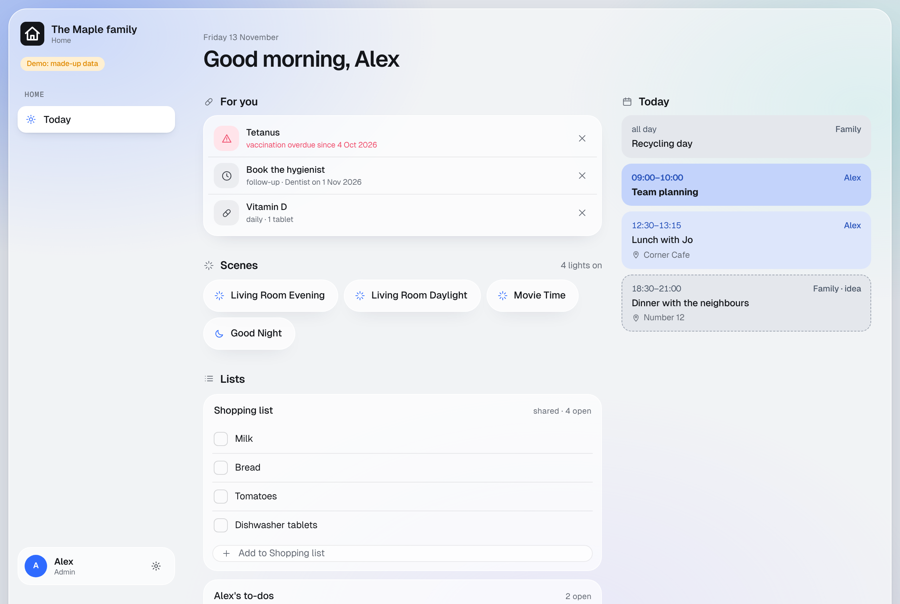

# Shell

The dashboard Worker (`<prefix>-shell`) and its pages: sign-in, Today, Settings and Security. It knows nothing about
notes, calendars or money. Those are modules that register with it, and they exist only where the household config
switches them on.

## What it serves

| Path | What | Who |
|---|---|---|
| `/login`, `/login/*` | the sign-in page (no script) and its own files | anyone |
| `/` | redirects to `/home` | |
| `/home` | Today: what needs you, scenes, lists, today's calendar | every person |
| `/settings` | theme for this device, the household, the way into management | every person |
| `/dashboard/security` | who signs in where, what talks to what, where each key lives | admins |
| `/api/me` | the person, their menu, which modules are on | every person |
| `/api/security` | the Security page's content | admins |
| `/api/<module>/*` | a module's API | as the module decides |
| `/favicon.svg`, `/manifest.webmanifest`, `/apple-touch-icon.png` | the icon, in each person's colour | every person |

Everything except `/login` is behind the sign-in, including the scripts and styles. Paths that belong to the gateway
(`/<name>/mcp`, `/oauth/*`, `/.well-known/*`) are never pages: if one reaches this Worker, the gateway's route is
missing and the answer is 404.

## Sign-in

Cloudflare Access sits in front of the whole domain and lets in only the household's email addresses. The Worker
does not trust that alone: it verifies the Access token on every request (signature, issuer, audience, expiry; see
`packages/core/src/access.ts`) and then looks the email up in the household config. Someone Access lets through who
is not in the config gets nothing. Admins are the people with `"admin": true`.

Writes need the header `X-Dashboard: 1` and the same origin, so another website cannot make a signed-in browser
change something.

## Files

| Path | What |
|---|---|
| `src/index.ts` | the routes above |
| `src/pages.ts` | which paths exist and who may open them; the menu per person |
| `src/modules.ts` | the list of modules built into the Worker (see below) |
| `src/security.ts` | builds the Security page from the household config and `secrets.manifest.json` |
| `src/login.ts`, `src/app-icon.ts` | the sign-in page; the per-person icon and manifest |
| `src/demo.ts` | demo mode |
| `web/` | the UI: plain TypeScript and CSS, no framework. `npm run build` compiles it into `public/` |
| `wrangler.jsonc` | generated by `setup/wrangler-config.mjs`. Do not edit by hand |

## Adding a module

A module adds pages, API routes and Security entries in two places:

1. **Worker:** a `ShellModule` in `src/modules.ts` (`id`, `pages`, `api`, `security`). Add it to `MODULES`.
2. **UI:** an entry in `web/src/modules.ts` (`UI_MODULES`) that draws each of its pages.

Both are ignored while the module is off in `household.config.json`. A module's API handler receives the verified
person and a `write` flag; it never reads a name or email from the request body.

### What Today asks modules for

Today shows a card only when its module answers. These are the contracts (the demo answers all of them from
`demo/data/`):

| Request | Module | Answer |
|---|---|---|
| `GET /api/calendar?from=YYYY-MM-DD&to=YYYY-MM-DD` | calendar | `{ events: [{ id, title, start, end, all_day, owner, calendar, location, idea }] }`; `owner` is a person id, or `null` for a shared calendar |
| `GET /api/ha` | homeAssistant | `{ scenes: [{ entity, name }], lights: [{ entity, name, on }], … }` |
| `POST /api/ha/scene` `{ scene }` | homeAssistant | `{ ok: true }` |
| `GET /api/lists` | homeAssistant | `{ lists: [{ entity, name, shared, items: [{ uid, text, done }] }] }`, only the lists this person may see |
| `POST /api/lists/add` `{ list, text }`, `POST /api/lists/done` `{ list, item, done }` | homeAssistant | `{ ok: true }` |
| `GET /api/health/mine` | health | this person's own reminders only: overdue vaccinations, follow-ups, current medication |

## Demo mode

`npm run demo` (here or in the repository root) runs this Worker's own code in Node with the var `DEMO_MODE` set to
`on`, and prints a local address. In demo mode there is no sign-in, the household is the made-up family in `demo/`,
every `/api` request is answered from `demo/data/`, and changes stay in memory. Settings gets a "View as" switch.

Never set `DEMO_MODE` on your own dashboard: it opens it to anyone with the address. The Security page shows a
warning while it is on.

## Commands

| Command | What |
|---|---|
| `npm run build` | compile the UI into `public/` |
| `npm run demo` | build, then serve the demo locally |
| `npm run dev` | build, then `wrangler dev`. Put `DEV_EMAIL=alex@example.com` in a git-ignored `.dev.vars` to be signed in as a person from your config |
| `npm run typecheck`, `npm test` | checks |

## Not here yet

- The one-time `/setup/keys` page that generates the encryption keys (setup phase).
- A database for the shell itself: core needs none. Modules bring their own.
