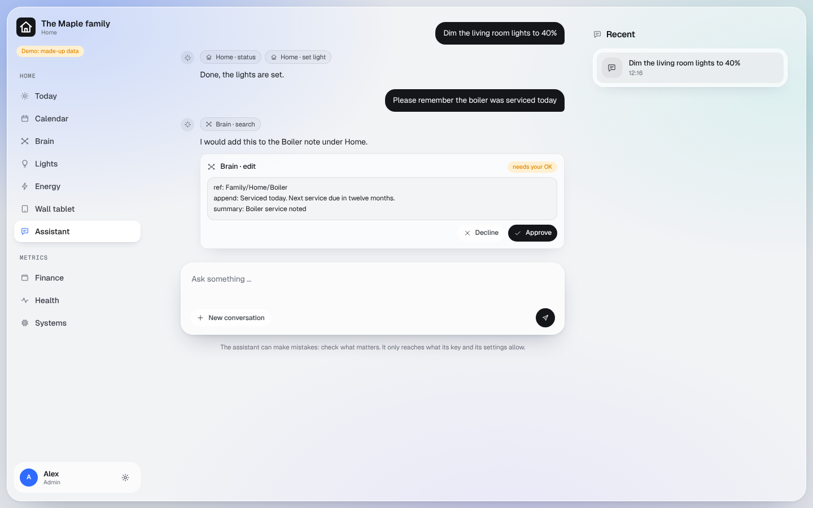

# Alfred

A chat assistant inside the dashboard. It answers questions about the house, the calendars, the notes and your own
records, and it can change things: lights at once, everything else only after you approve a card.

## What you get

- **Home > Assistant**: chat, with a card for every change it wants to make (Approve or Decline).
- **Settings > Assistant settings** (admins): its name (Alfred is only the default), its tone, and check boxes for
  what it may read and change per module. [Screenshot](../screenshots/assistant-settings.png)
- It works with whatever modules you have. With none, it can still talk.

## What it may do

- Reading runs. Lights, scenes and list items run at once (quick to undo). Everything else waits for your Approve.
- Archiving, deleting, plugs and computer commands are never offered.
- **Finance** is for admins only.
- **Health**: each person reaches their own records. An admin can write to someone else's only by asking in their
  own words, which are shown on the card.
- **Calendars**: each person reaches their own calendar and the shared one. The setting **"Admins can open
  everyone's calendars"** (Assistant settings, off by default) lets an admin also ask about another person's calendar
  by name. Everyone else stays with their own.
- Conversations delete themselves 30 days after the last message. A health conversation leaves no text in the logs.

## What you need

An Anthropic API key. It is billed per message by Anthropic; a normal day of family use costs cents, and a daily
limit stops it if something runs away.

## Your hands

1. At console.anthropic.com, create an account, add a payment method and create an API key named "dashboard".
2. Save it in your password manager as `ALFRED_ANTHROPIC_API_KEY` and put it on the Worker `<prefix>-alfred` as shown
   in [secrets.md](../secrets.md#putting-a-secret-into-cloudflare-yourself).

What goes to Anthropic: the messages, first names, the time zone and what the tools return for that turn. Never an
email address.

## Without Alfred

You do not need Alfred to talk to your dashboard: connect your own Claude or ChatGPT app instead (see
[using your dashboard](../using-your-dashboard.md#connecting-claude-or-chatgpt)). That uses your existing plan, with no
API key.
