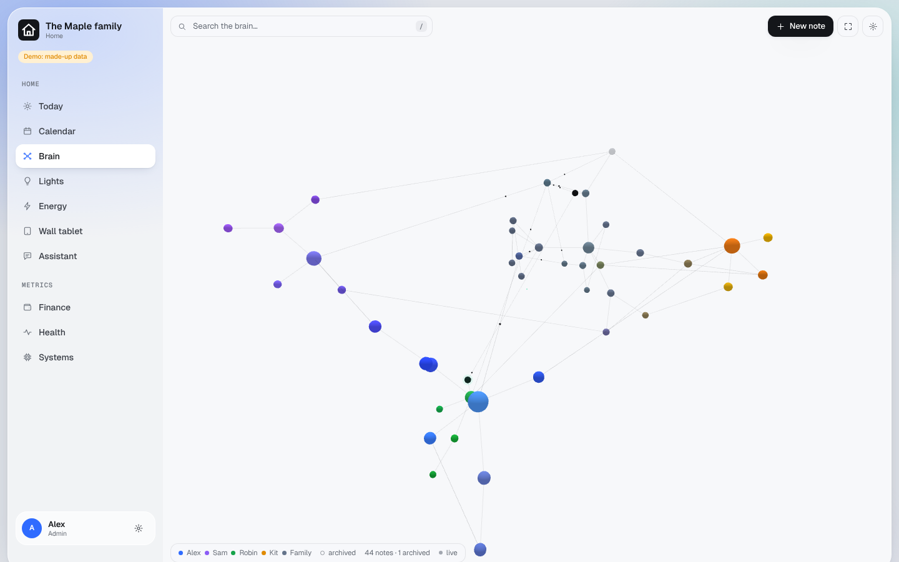

# Brain

Shared long-term notes for the household, drawn as a map. Your own AI app reads and writes them through the gateway,
so it remembers what matters to your family across conversations.

## What you get

- **A tree of notes**: one branch per person (their first name) and one shared branch, "Family". Notes link to each
  other with `[[Note title]]`.
- **The map** (Home > Brain): every note is a dot in its branch's colour. Click to read or edit, `/` to search,
  "New note" to add. Changes from your AI app show up within 20 seconds.
- **History**: every edit keeps the earlier version; nothing is ever deleted. Notes can be archived and locked.
- **A sensitive tier**: notes under a branch called `Health` or `Private` are encrypted. Each person reaches their own
  and the shared ones only.
- **For your AI app**: `https://<your dashboard>/brain/mcp`.

## What you need

Nothing beyond the core. The key page makes `BRAIN_SENSITIVE_ENCRYPTION_KEY`; keep it in your password manager.
**If it is lost, sensitive notes can never be read again.** Everything else keeps working.

## Good to know

- Text that looks like a password, an API key or a card number is refused. Note *where* a secret lives, never its
  value.
- Left out on purpose: file attachments and importing an existing notes folder.
