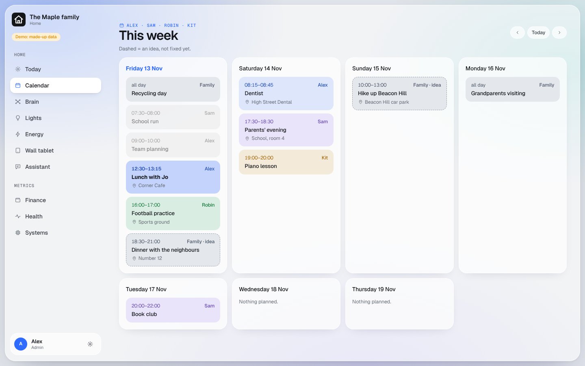

# Calendar

Your iCloud calendars on the Today page, a week view, and for your AI app.

## What you get

- **Calendar** (Home > Calendar): this week, each person's events in their colour, the shared ones in grey.
- **Today**: your own events and the shared ones.
- **For your AI app**: `https://<your dashboard>/calendar/mcp`, where each person's calendar and the shared one have
  their own permissions (read, add, change, remove).
- **Ideas and plans**: an event whose title is in round brackets, "(dinner with friends)", is shown as an idea, not
  yet fixed. Remove the brackets once it is.

## What you need

One Apple ID that owns or is shared the calendars, and in it:

- one calendar per person, named exactly like the person's first name in the dashboard (for example "Alex");
- one shared calendar called **Family**.

A calendar that does not exist yet is simply left out; create it in the Calendar app and it appears within six
hours. Other calendars in that Apple ID are never read.

## Your hands

1. Go to account.apple.com > Sign-In and Security > **App-Specific Passwords** > add one, named "dashboard".
2. Save it in your password manager as `CALENDAR_ICLOUD_APP_PASSWORD`, and the Apple ID's email address as
   `CALENDAR_ICLOUD_USER_ID`.
3. Put both on the Worker `<prefix>-calendar` as shown in [secrets.md](../secrets.md#putting-a-secret-into-cloudflare-yourself).

Never use your Apple ID's own password. The app-specific password can be revoked at any time at account.apple.com,
and it is only ever sent to Apple.
