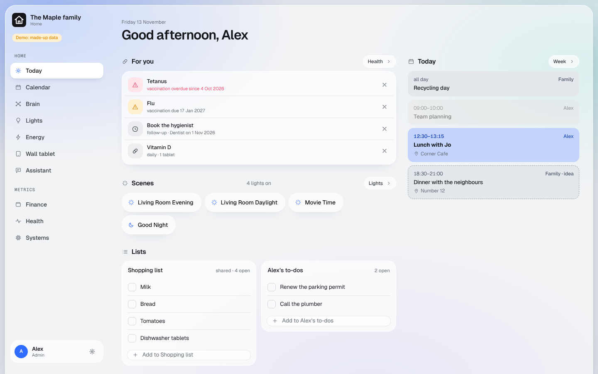

# Core

Always on. The dashboard itself: sign-in, a Today page for each person, Settings and the Security page.

## What you get

- **Sign-in with a passkey.** Cloudflare Access lets in only the email addresses in your household config, then the
  dashboard checks every request again. Someone not in the config gets nothing.
- **Today**, per person: what needs you, scenes, today's calendar and your lists, depending on the modules you have.
- **Settings**: light, dark or system theme for each device; who is in the household; for admins, the way to every
  management page.
- **Security** (admins): a map of who signs in where, what talks to what, where each key lives, and a checklist for
  your install. [Screenshot](../screenshots/security.png)
- **Encryption keys** (admins, once): the page where your browser makes the keys for the encrypted modules.
  [Screenshot](../screenshots/key-page.png)
- **The gateway**: the addresses your own Claude or ChatGPT app connects to. See
  [using your dashboard](../using-your-dashboard.md#connecting-claude-or-chatgpt).

## What you need

A domain on Cloudflare, Zero Trust turned on, and for each person a first name and the email address they sign in
with. Up to six people. At least one admin.

## Your hands

- Connect Workers Builds to your repository (so merges go live).
- Require a passkey in Zero Trust.

Both are in [getting started](../getting-started.md#clicks-only-you-can-do).
