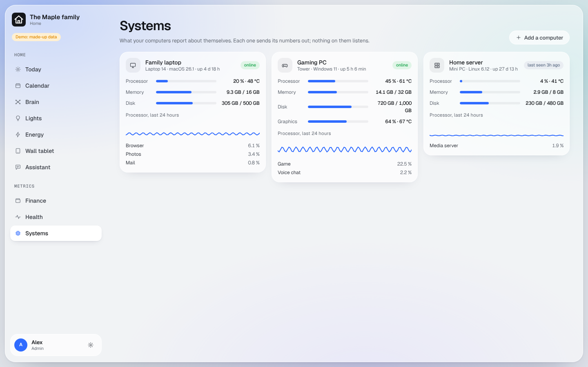

# Edge agents

A small program on each of your computers that sends its processor, memory, disk and temperature to the dashboard,
and can run a short, fixed list of safe commands.

## What you get

- **Metrics > Systems**: one card per computer, with its load over the last day.
- **Settings > Edge agents**: add a computer, approve it, choose its commands, confirm a shutdown.
  [Screenshot](../screenshots/edge-agents.png)
- **For your AI app**: `https://<your dashboard>/devices/mcp`.

Commands: check the agent is alive, wake another computer, cancel a shutdown, and shut down a Windows PC. A shutdown
waits until an admin confirms it on the Edge agents page; an AI app can ask for one but never confirm it.

The agent never collects command lines, window titles, files, browsing, keystrokes, screenshots or location. It only
calls out; nothing on the computer listens.

## What you need

A Mac, Windows or Linux computer you can install a program on. The program is built from this repository's `agent/`
folder with Go; your AI can do that for you on the computer.

## Your hands, per computer

1. In Cloudflare Zero Trust > Access > Service auth, create a service token named `<prefix>-agent-<computer>` (your
   AI tells you the exact name). Save both halves in your password manager as `AGENT_<COMPUTER>_SERVICE_TOKEN_ID` and
   `AGENT_<COMPUTER>_SERVICE_TOKEN_KEY`. You make this one yourself so the secret half never passes through your AI.
2. Tell your AI it exists; it lets that token, and no other, through to the dashboard.
3. Settings > Edge agents > **Add a computer** gives you a one-time code and a command to run on the computer.
4. Compare the fingerprint the computer prints with the one on the page, and approve.
