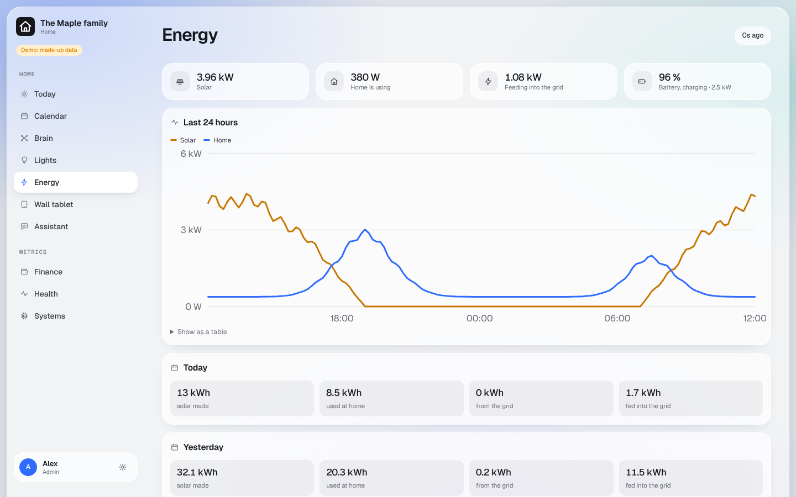

# Energy

What your home makes, uses, stores and buys, worked out from your Home Assistant power sensors. No other account,
no vendor cloud. Needs the Home Assistant module.

## What you get

- **Home > Energy**: solar, the house, the grid and the battery right now; today and yesterday in kWh; the last 24
  hours as a chart; your devices by draw.
- **Wall tablet**: the same numbers, large.
- **For your AI app**: the energy picture is part of `home_status` on `/home/mcp`.

## What you need

Power sensors in Home Assistant (in watts or kilowatts): at least one of solar, grid or battery.

## Your hands

Open **Settings > Energy sensors**. The dashboard guesses from your sensors' names; check the guess and press Save.
[Screenshot](../screenshots/energy-sensors.png)

- **Grid**: positive should mean buying. Tick "negative when buying" if your meter reports it the other way round.
- **Battery**: positive should mean charging. Same tick box for the other way round.
- **Whole house**: leave on "Work it out" unless you have a sensor for it.

The totals add up one-minute readings, so they are close to, not equal to, your meter.
