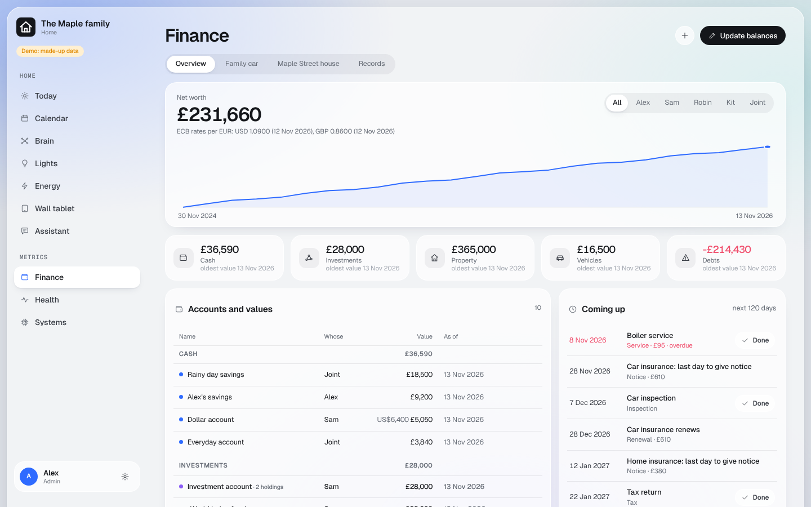

# Finance

The household's money in one place: accounts with dated balances, investments, property and vehicles, contracts,
deadlines and tax years. Encrypted. Admins only.

## What you get

- **Metrics > Finance**: net worth over time, accounts and their values, what is coming up (renewals, notice
  periods, inspections).
- **Totals in your currency** (`currency` in the household config). Other currencies convert with the European
  Central Bank's daily rates.
- **For your AI app**: `https://<your dashboard>/finance/mcp`. Hand it a statement or a contract and ask it to file
  the balance or the deadline.
- **Nothing is deleted**: a record is archived and can be brought back. Balances are only ever added, by date.

## What you need

Nothing beyond the core. The key page makes `FINANCE_DATA_ENCRYPTION_KEY`; keep it in your password manager.
**If it is lost, finance records can never be read again.**

## Good to know

- Store the last four digits of an account or card at most. Never PINs or passwords.
- Bank statement import is left out (every bank's format differs): add rows on the page, or let your AI app file them.
