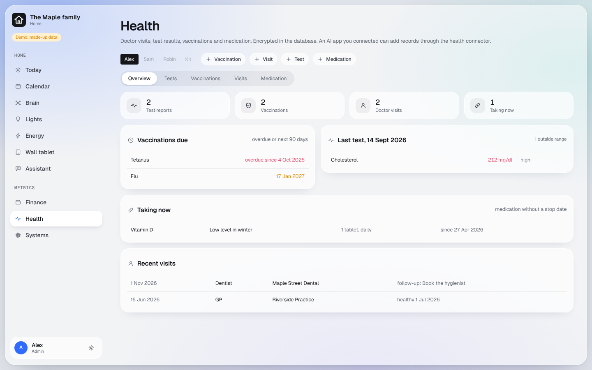

# Health

Each person's doctor visits, test results, vaccinations and medication. Encrypted, never logged.

## What you get

- **Metrics > Health**: each person sees their own records; an admin sees everyone's.
- **Today, "For you"**: vaccinations due, follow-ups to book, medication you are taking.
- **Test results over time**, with values outside the reference range flagged.
- **For your AI app**: `https://<your dashboard>/health/mcp`. Hand it a lab report and ask it to file it for you.
- **Nothing is deleted**: archiving hides a record, and every change keeps the earlier version.

## What you need

Nothing beyond the core. The key page makes `HEALTH_DATA_ENCRYPTION_KEY`; keep it in your password manager.
**If it is lost, health records can never be read again.**

## Good to know

- Only whose record it is, its type and its date are readable in the database. Everything else is encrypted.
- Health data is never written to logs, the Brain or any other module. The dashboard is a filing cabinet, not a
  doctor: it flags values, it does not diagnose.
