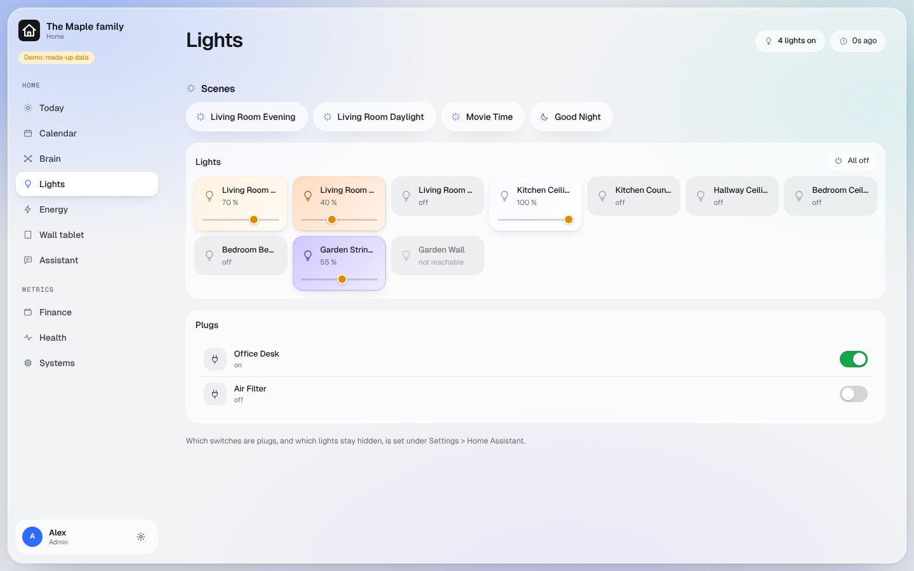

# Home Assistant

Lights, scenes, plugs and to-do lists from your own Home Assistant. Nothing in your home is opened to the internet:
Home Assistant calls out through its Cloudflared add-on, and only the dashboard may use that tunnel.

## What you get

- **Home > Lights**: every light as a tile (tap to switch, drag to dim), scenes, and the switches you chose as plugs.
- **Today**: the scenes, and each person's shared and own to-do lists.
- **Settings > Home Assistant**: a connection check, whose list is whose, which switches are plugs, which scripts sit
  with the scenes, which lights stay hidden. [Screenshot](../screenshots/home-assistant-setup.png)
- **For your AI app**: `https://<your dashboard>/home/mcp`.

The dashboard can do five things and no others: switch a light, run a scene, run a script you ticked, switch a
switch you ticked, and read and add to your to-do lists.

## What you need

Home Assistant running at home, and an admin account on it. Any to-do list in Home Assistant (for example its
Shopping List) can appear on the dashboard.

## Your hands

Your AI sets up the Cloudflare side and tells you the tunnel's address (for example `ha.example.com`). Then:

1. **Cloudflared add-on.** In Home Assistant: Settings > Add-ons > Add-on store, install **Cloudflared**, and give it
   the tunnel address your AI named. Start it.
2. **A user for the dashboard.** Settings > People > Add person, allow sign-in, **not** an administrator. Sign in as
   that user, open its profile > Security > **Long-lived access tokens** > Create.
3. Save the token in your password manager as `HA_API_LONGLIVED_TOKEN` and put it on the Worker `<prefix>-shell`
   as shown in [secrets.md](../secrets.md#putting-a-secret-into-cloudflare-yourself).
4. Open **Settings > Home Assistant** in the dashboard: green ticks mean it works. Assign the lists and tick your
   plugs.
