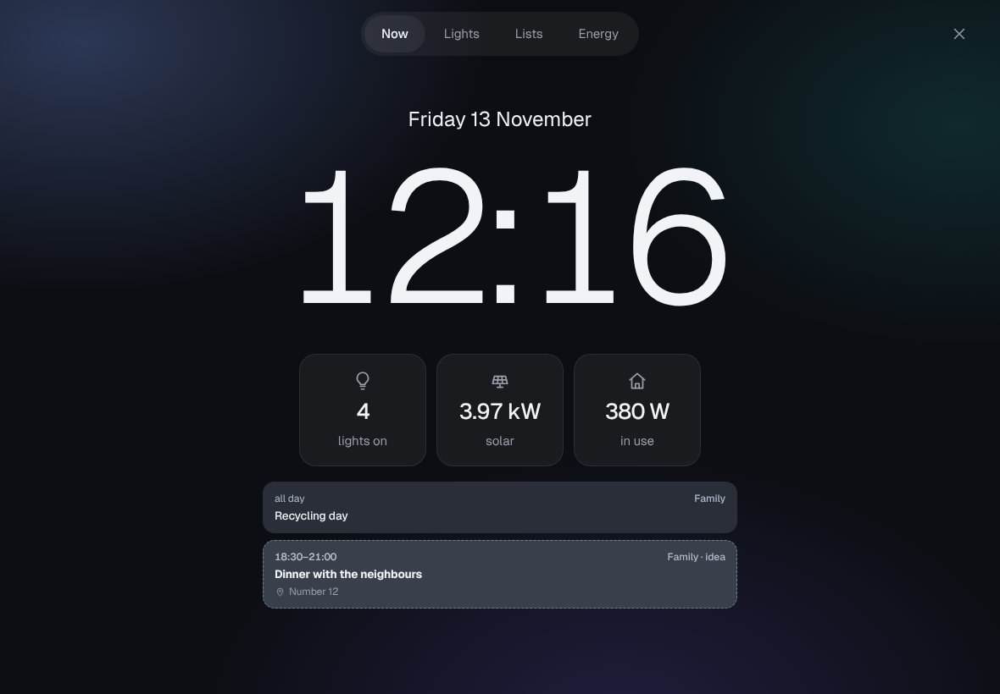

# Kiosk: wall tablets

A tablet on the wall with a clock, the lights and scenes, the shared lists and the energy numbers. Needs the Home
Assistant module.

## What you get

A tablet is not a person: it never signs in, never sees anyone's own lists or records, and cannot open Settings. It
lives on its own address (for example `kiosk.example.com`) and stays paired for 180 days.

## Pairing a tablet

1. On the tablet, open `https://<kiosk address>/pair`. It shows a code for 10 minutes.
2. On your own phone or computer, open **Settings > Wall tablets**, type the code and say where the tablet hangs.
   [Screenshot](../screenshots/wall-tablets.png)
3. The tablet opens the wall page within a few seconds. Add it to the home screen for full screen.

Settings > Wall tablets lists every tablet and when it was last on. Revoke one with two taps; it falls back to the
pairing page.
