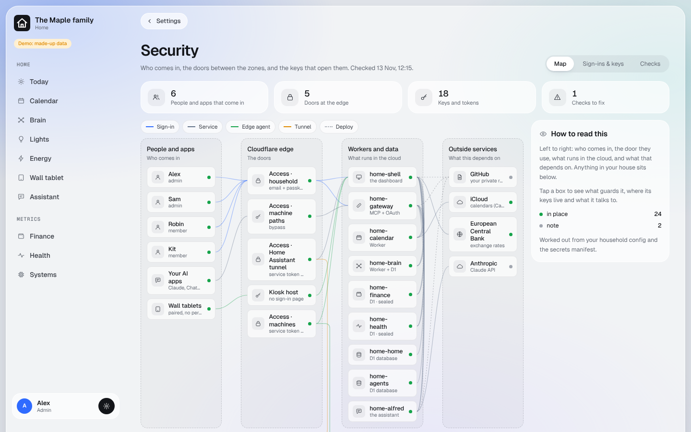

# Security

How your dashboard keeps your household's data to your household, in plain words. The **Security page** of your
own dashboard (Settings > Security, admins) shows the same picture for your install, with a checklist.

## Who gets in

- **People** sign in through Cloudflare Access with their email address and a passkey. Access lets in only the
  addresses in your household config, and the dashboard checks the sign-in again on every request. Someone Access
  lets through who is not in the config gets nothing.
- **Admins** (`"admin": true`) see Metrics and the management pages. Everyone else sees Today, the home controls and
  their own health records.
- **Another website** cannot make your signed-in browser change something: every change must come from the
  dashboard's own pages.

## Your AI apps

- Claude, ChatGPT or another app connects to one module's address at a time, through OAuth.
- A person of your household approves each connection on a page behind the same sign-in, and unticks what the app
  should not do. The dashboard enforces those ticks on every call.
- Only known apps can receive a connection (Claude and ChatGPT, or an app on the same computer).
- A connection ends after 90 days without use. Every call is logged by name, never by content.

## Machines

- **Home Assistant** is reached through a tunnel it opens itself. Only the dashboard holds the pass for that tunnel,
  and inside, Home Assistant checks its own token of a user who is not an administrator. The dashboard can switch
  lights, run scenes and the scripts and switches you ticked, and use your lists. Nothing else.
- **Edge agents** each have their own Cloudflare pass and sign every request with a key that never leaves the
  computer. Commands to them are signed by the dashboard; a shutdown waits for an admin's confirmation.
- **Wall tablets** never sign in as a person. They hold a 180-day pairing key and can reach eight things, all shared:
  no personal lists, records or settings.

## Your data

- Everything lives in your own Cloudflare account: databases (D1), small stores (KV) and Workers. Nothing is sent to
  the author of this template or any analytics service.
- **Encrypted with your own keys:** the Brain's sensitive notes, all finance records, all health records. The keys
  are made in your browser on the one-time key page, stored as Cloudflare secrets, and saved by you in your password
  manager. Your AI never sees them. **A lost key means the data it protects is lost.**
- **Nothing is deleted.** Records are archived and can be brought back; edits keep the earlier version.
- **Health data** is never written to a log, a note or another module.

## Your AI during setup

- It works with a Cloudflare token that you make, that expires within 7 days, and that you delete at the end. Setup
  only finishes once that token no longer works.
- After setup, Cloudflare deploys changes with its own build token, and your AI may keep a **read-only** token to
  read logs.
- It never asks for, prints or stores a secret's value, and your repository must stay private.

## What this does not protect against

- Someone who controls your Cloudflare or GitHub account. **Turn on two-factor sign-in for both.**
- Someone holding your unlocked phone or computer while you are signed in.
- Mistakes in this code. It is provided as is, with no warranty and no support. You run it yourself, on your own
  accounts.

## Reporting a problem

If you find a security problem in this template, do not open a public issue with the details. Fix it in your own
copy (your AI can help), and contact the author privately through GitHub if you think others are affected.
