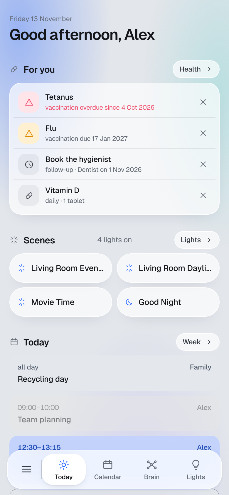
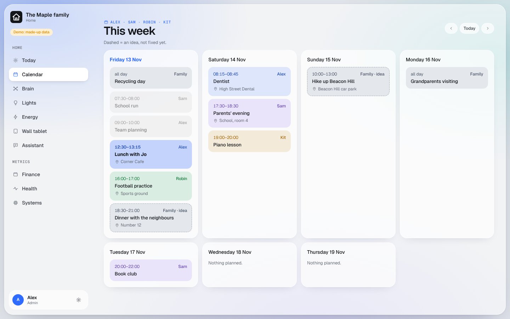
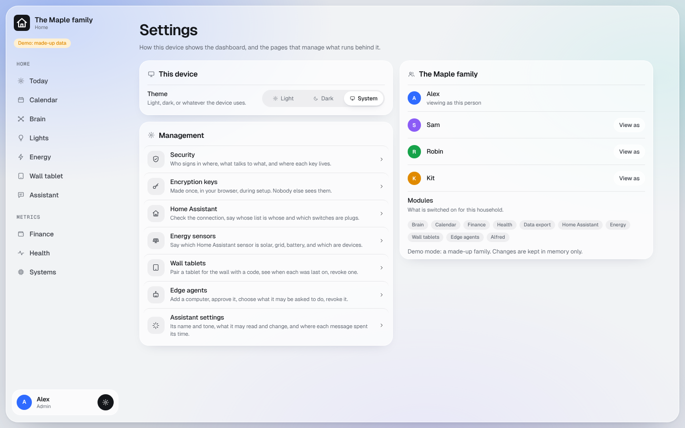
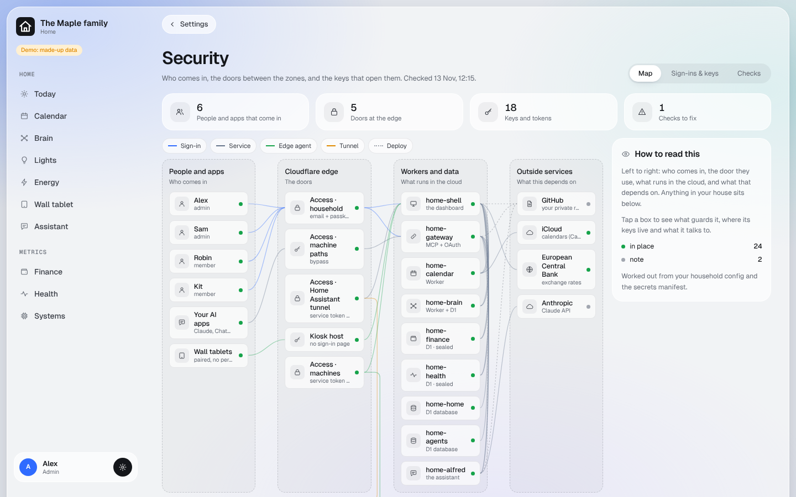
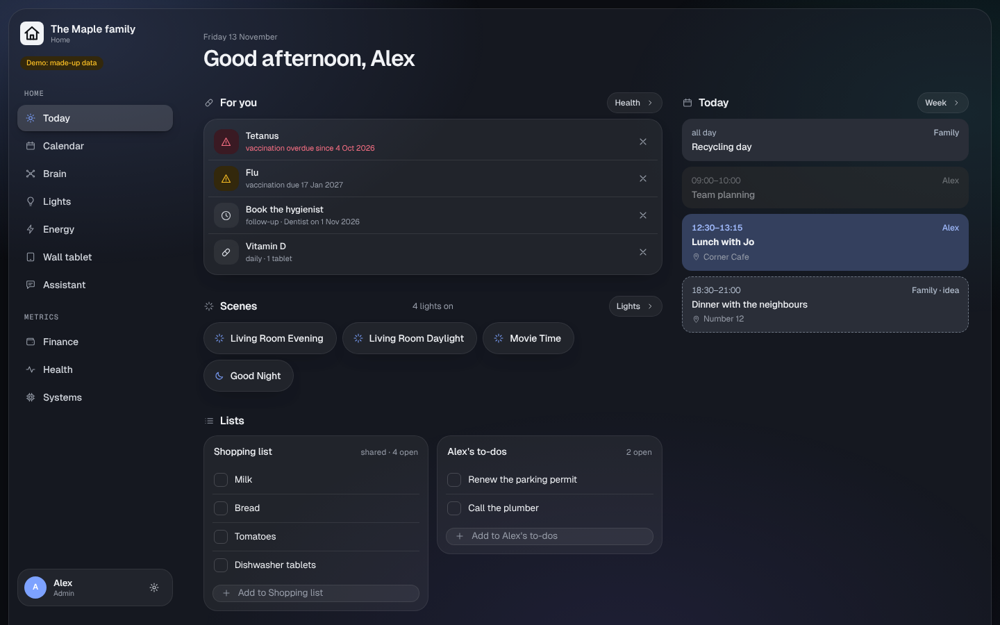

# Using your dashboard

## Signing in

Open your dashboard's address (for example `https://home.example.com`). Cloudflare asks for your email address and
your passkey (Face ID, Touch ID, Windows Hello). Only the people in your household get in; the dashboard checks again
on every page.

On a phone, use **Share > Add to Home Screen** (iPhone) or **Install app** (Android): the dashboard opens full screen,
with an icon in your own colour.

## What everyone sees

| Page | What |
|---|---|
| **Today** | what needs you (health reminders), scenes, today's calendar, your lists |
| **Calendar** | the week: your calendar, the shared one, everyone's |
| **Brain** | the notes map: click a dot to read or edit, `/` to search |
| **Lights**, **Energy**, **Wall tablet** | with the Home Assistant modules |
| **Assistant** | with Alfred |
| **Health** | your own records |
| **Settings** (the gear on your name) | light or dark theme for this device, who is in the household |

Admins also see **Metrics** (Finance, Systems) and the management pages under Settings: Security, encryption keys,
Home Assistant, energy sensors, wall tablets, edge agents and the assistant's settings.

| | |
|---|---|
|  |  |
|  |  |

## Connecting Claude or ChatGPT

Your own AI app can read and, if you allow it, change your dashboard's data. Each module has its own address:

| Module | Address |
|---|---|
| always | `https://<your dashboard>/household/mcp` |
| Brain | `https://<your dashboard>/brain/mcp` |
| Calendar | `https://<your dashboard>/calendar/mcp` |
| Finance | `https://<your dashboard>/finance/mcp` |
| Health | `https://<your dashboard>/health/mcp` |
| Home Assistant | `https://<your dashboard>/home/mcp` |
| Edge agents | `https://<your dashboard>/devices/mcp` |

- **Claude** (app or claude.ai): Settings > Connectors > **Add custom connector**, paste one address, Connect.
- **ChatGPT**: Settings > Apps & Connectors > Advanced > turn on Developer mode, then **Create** and paste one
  address.

Your dashboard's sign-in opens, then a page that lists what the app may do. Untick anything it should not do (for
example "remove events") and approve. Each connection works for that one address only, and stops after 90 days
without use. Every call is written to the gateway's audit log.

Ask your AI app things like *"What's on the family calendar this weekend?"* or *"Note in the Brain that the boiler
was serviced today."*

## Changing things later

Ask your AI, in your private repository: *"Add Robin to the household"*, *"Switch on the energy module"*. It changes the code or
`household.config.json`, opens a pull request on GitHub and tells you what it changed. When you (or it) merge the pull request, Cloudflare puts the change live within a few minutes. To undo
a change, ask it to revert that pull request.

A new person also needs to be let in at the door: your AI does that by running the setup step again, which updates
the Cloudflare Access list. A new module may bring a new secret or encryption key; your AI tells you.

## Keeping it healthy

- Look at **Settings > Security** now and then: it shows a checklist for your install.
- Keep two-factor sign-in on your GitHub and Cloudflare accounts.
- If something stops working, see [troubleshooting.md](troubleshooting.md).
